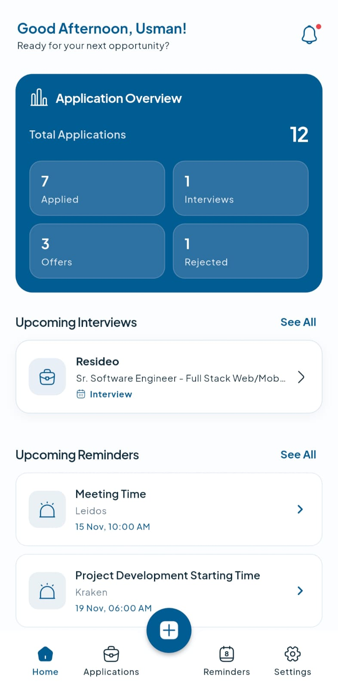
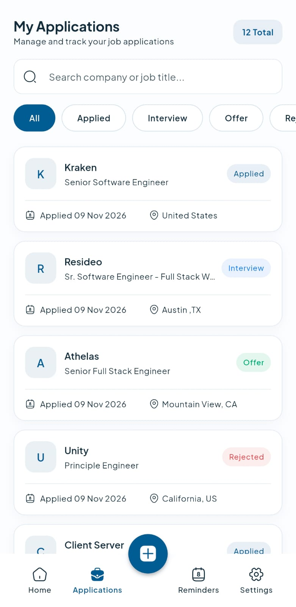
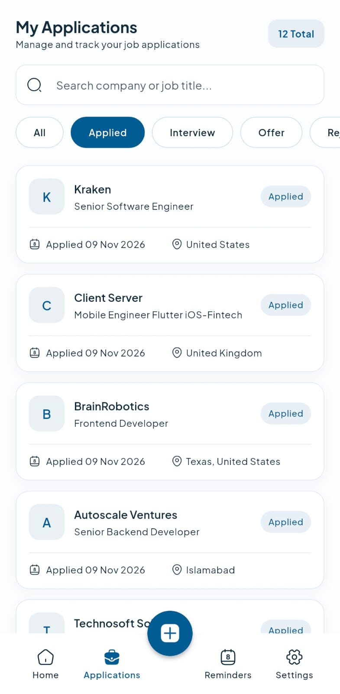
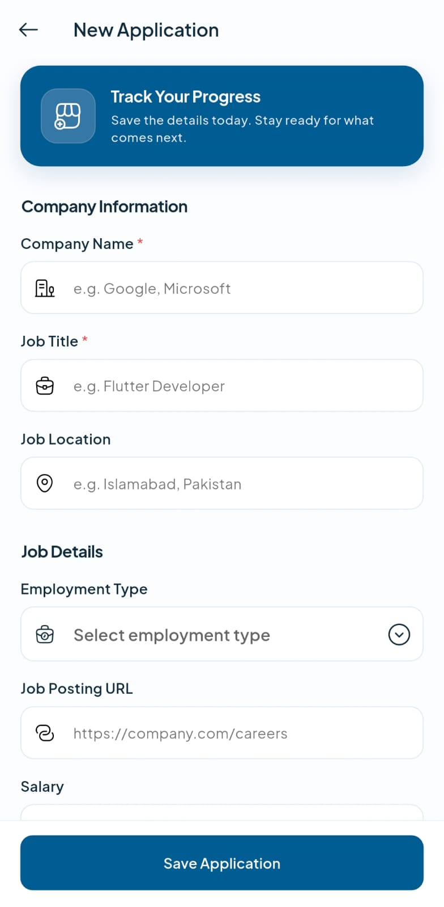
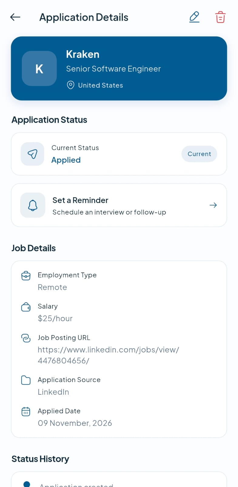
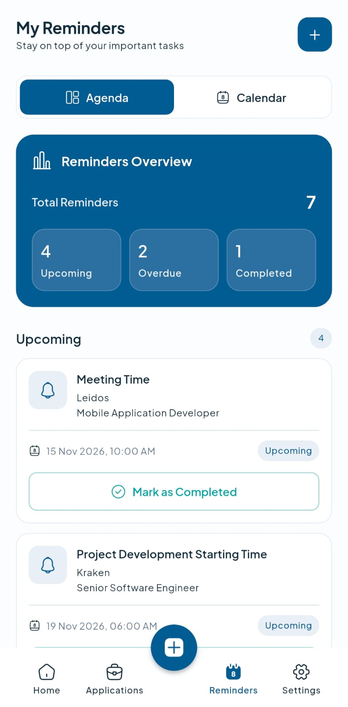
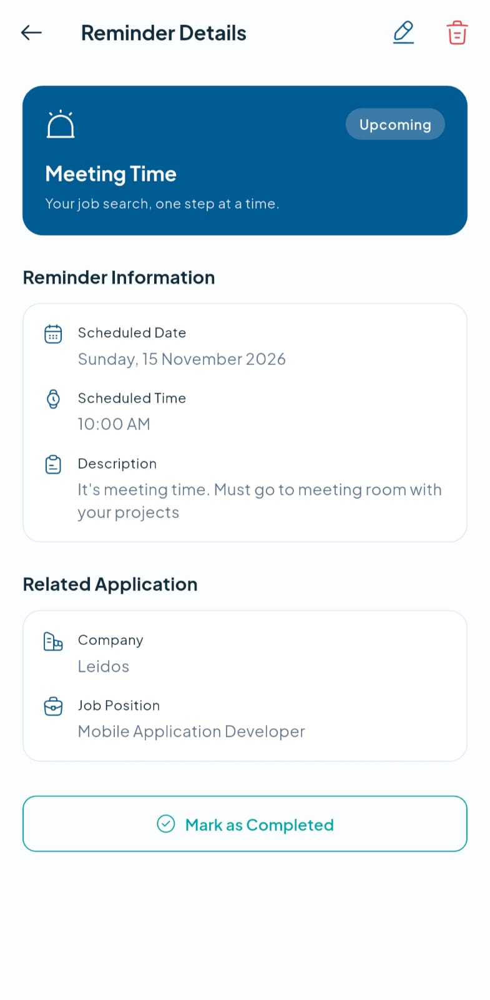
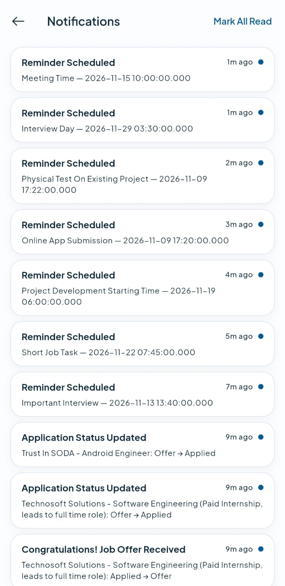
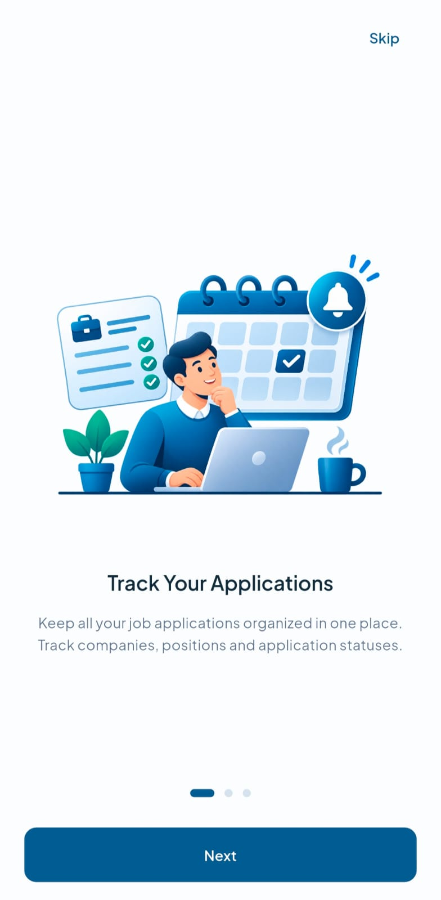
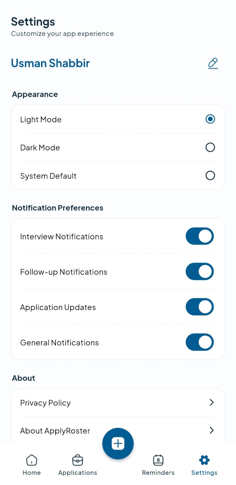

# Apply Roster

**Take control of your job search.**

Apply Roster helps you organize job applications, track application progress, manage interview reminders, and keep your job search on track — all in one place.

## Overview

Applying for jobs can quickly become difficult to manage. Apply Roster provides a centralized workspace to keep track of your applications, monitor their status, and stay prepared for upcoming interviews.

## Features

- **Dashboard:** Get an overview of your job search and application statistics.
- **Application Management:** Add, edit, view, and manage job applications.
- **Application Tracking:** Monitor application statuses, including applied, interviewing, offered, and rejected.
- **Interview Reminders:** Schedule reminders for interviews and important follow-ups.
- **Notifications:** Receive local notifications for upcoming reminders.
- **Application Details:** Keep company information, job descriptions, notes, and job posting links organized.
- **Statistics:** View insights into your application progress.
- **Dark & Light Mode:** Switch between themes.
- **Offline Storage:** Keep your application data stored locally on your device.

## App Screenshots

### Dashboard


### Applications




### Add & Manage Applications




### Reminders & Notifications






### Onboarding & Settings




## Technology Stack

- Flutter & Dart
- GetX
- SQLite (sqflite)
- SharedPreferences
- Flutter Local Notifications
- FL Chart
- Plus Jakarta Sans

## Getting Started

### Prerequisites

- Flutter SDK
- Dart SDK
- Android Studio or VS Code

### Installation

1. Clone the repository:

   ```bash
   git clone https://github.com/Usman4014/apply-roster.git
   ```

2. Navigate to the project directory:

   ```bash
   cd apply-roster
   ```

3. Install dependencies:

   ```bash
   flutter pub get
   ```

4. Run the application:

   ```bash
   flutter run
   ```

## Project Status

Apply Roster is a completed personal portfolio project. The application is prepared for its Google Play release process.

## Author

**Usman Shabbir**

Flutter Developer

GitHub: [@Usman4014](https://github.com/Usman4014)

---

*Built with a focus on simplifying and organizing the job application journey.*